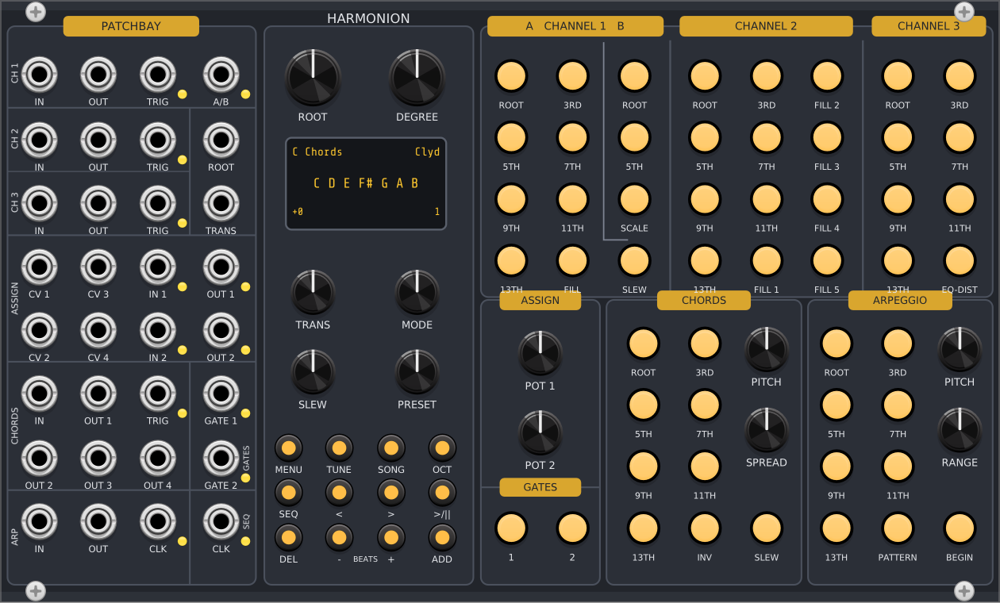

# Harmonion

Plugin para VCV Rack 2 inspirado no ACL Sinfonion: três quantizadores, gerador de acordes de
quatro vozes, arpejador e sequenciador de progressões, todos compartilhando a mesma harmonia.
Reimplementado do zero a partir do manual público; veja [SPEC.md](SPEC.md).



## Compilar

Requer MSYS2 (MINGW64) com `mingw-w64-x86_64-gcc`, `make`, `zstd`, `jq` e o Rack SDK 2.6 em `dep/Rack-SDK`.

```bash
make -j8 dist
```

Copie `dist/Harmonion-2.0.0-win-x64.vcvplugin` para `%LOCALAPPDATA%\Rack2\plugins-win-x64\` e reinicie o Rack.

## Testes

```bash
g++ -std=gnu++17 -O1 -DARCH_WIN -D_USE_MATH_DEFINES -Idep/Rack-SDK/include -Idep/Rack-SDK/dep/include src/Harmony.cpp src/Harmonion.cpp src/Buttons.cpp test/test.cpp -Ldep/Rack-SDK -lRack -o build/test.exe
```

Rode `build/test.exe` com a pasta do Rack (`libRack.dll`) no `PATH`.

## Diferenças em relação ao hardware

- **Atalhos de dois dedos**: segurar PATTERN, BEGIN ou INV e apertar outro botão funciona, mas com
  mouse não dá para segurar dois botões ao mesmo tempo. Por isso o menu de contexto (clique direito)
  também escolhe padrão, início e inversão. O display mostra o valor novo ao mudar.
- **Factory reset e calibração**: no hardware são combinações de botões; aqui ficam no menu de contexto.
- **Harmonic Link**: OUT 1 = "Sync Master" envia um cabo polifônico de 16 canais. IN 1 = "Sync Slave" recebe.
- **Gates e triggers** saem com 10 V (padrão do VCV) em vez de 5 V.
- Partes que o manual não detalha (lista completa das escalas dos modos, opções do A/B do canal 1,
  algumas faixas de menu) foram reconstruídas e estão marcadas com `// reconstruído` no código.
